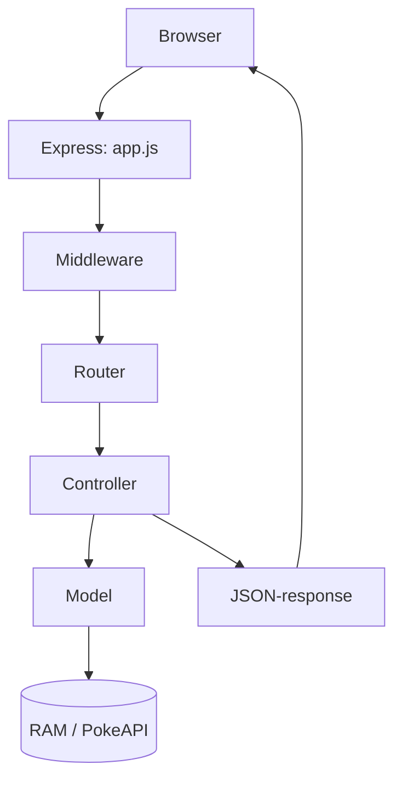

# PokéArena – fuldt fungerende løsning

En webapplikation med **HTML, CSS, JavaScript, Node.js, Express, MVC, middleware, CRUD og PokeAPI**. Udviklet som løsningsforslag til programmering 2, uge 44.

## Start i WebStorm

1. Åbn projektmappen, hvor `package.json` ligger.
2. Kør `npm install`.
3. Kør `npm start`.
4. Åbn **http://localhost:3001** i browseren.

Hvis porten er optaget, kan du i PowerShell skrive `$env:PORT=3002; npm start` (eller ændre `PORT` i en WebStorm Run Configuration).

## Funktioner

- Søg Pokémon på navn eller ID. Navn, typer, artwork og base stats hentes via PokeAPI.
- Tilføj op til seks forskellige Pokémon til holdet.
- Vis hele holdet, redigér noter, og fjern Pokémon.
- Tydelige fejlmeddelelser ved ugyldigt input, ukendte Pokémon og eksterne API-fejl.
- Backend håndhæver holdgrænse og dubletregler med HTTP 409.
- Pokémon-billeder vises via deres numeriske `pokemonId`.
- Data gemmes **kun i RAM** og forsvinder ved genstart. MongoDB kan tilføjes i uge 45.

## Endpoints

| Metode | URL | Funktion |
|---|---|---|
| GET | `/pokemon/pikachu` | Slå Pokémon op via PokeAPI |
| GET | `/favorites` | Vis hele holdet |
| GET | `/favorites/1` | Hent favorit |
| POST | `/favorites` | Tilføj favorit |
| PUT | `/favorites/1` | Opdatér favorit (inkl. note) |
| DELETE | `/favorites/1` | Fjern favorit |
| GET | `/api/health` | Kontroller serverstatus |

Eksempel på POST/PUT-body: `{"name":"pikachu","pokemonId":25,"note":"Hurtig angriber"}`.

## Arkitektur

- `public/`: UI. `fetch()` kalder kun vores egen backend.
- `routes/`: Matcher metode og URL.
- `middleware/`: Inputvalidering, logning og central fejlhåndtering.
- `controllers/`: HTTP-status og request/response.
- `models/`: Lager i RAM og ekstern PokeAPI-integration.

## Test

Kør `npm test` for automatiske backend-tests. Test også manuelt:

1. Søg `pikachu` – status 200, artwork og stats vises.
2. Søg `ukendtpokemon123` – status 404 med tydelig fejl.
3. Tilføj seks forskellige Pokémon – alle vises.
4. Prøv en syvende – HTTP 409, UI viser besked.
5. Prøv samme Pokémon to gange – HTTP 409.
6. Redigér note og slet favorit – PUT 200 og DELETE 204.
7. Genstart serveren – teamet er tomt, fordi vi ikke har database endnu.

### Bemærk om billeder

Billed-URL'er hentes fra PokeAPI og [PokeAPI/sprites](https://github.com/PokeAPI/sprites). Billeder kræver netadgang, ligesom Pokémon-opslag. Pokémon og relateret grafik tilhører deres respektive rettighedshavere. Appen er kun til undervisning.

UI bruger Google Fonts, hvis nettet er tilgængeligt; ellers bruges systemskrifter.
